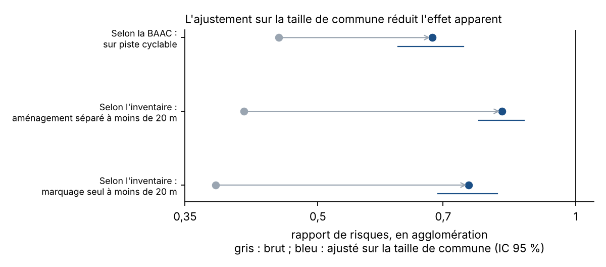

# Accidents de vélo en France, 2020-2024

Quels accidents de vélo sont les plus graves, où et quand ont-ils lieu ? Ce dépôt traite les données publiques des accidents corporels de la route (BAAC) pour les cyclistes et les croise avec une seconde source, l'inventaire national des aménagements cyclables. Il comprend :
1. un dictionnaire des données des deux sources ;
2. le croisement des données dans l'espace, le temps et par thème, avec des hypothèses testées ;
3. la confrontation des deux sources sur une même question, les pistes cyclables ;
4. la détection des points noirs, lieux où les accidents se répètent ;
5. un modèle commun pour accueillir d'autres sources (enquêtes, capteurs embarqués) ;
6. un tableau de bord en ligne.

**Tableau de bord** : https://mouhammadyadex34.github.io/velo-securite/
**Dictionnaire des données** : [`docs/dictionnaire_donnees.md`](docs/dictionnaire_donnees.md)
**Modèle commun** : [`docs/modele_commun.md`](docs/modele_commun.md)


## Résultats

**Le corpus.** De 2020 à 2024, 27 885 accidents corporels ont impliqué un vélo ou un vélo à assistance électrique (VAE). On y compte :
- 29 446 cyclistes victimes ;
- 8 080 gravement atteints, c'est-à-dire tués dans les 30 jours ou hospitalisés plus de 24 h ;
- dont 1 155 tués.

La part des cyclistes victimes qui roulaient en VAE passe de 6,2 % en 2020 à 13,6 % en 2024.

La mesure utilisée est la part de cyclistes gravement atteints dans chaque groupe. Deux groupes sont comparés par un rapport de risques (RR), avec son intervalle de confiance à 95 %.

| Hypothèse | Groupe comparé | Part de victimes graves | RR [IC 95 %] |
|---|---|---|---|
| H1 Localisation | Hors agglomération vs en agglomération | 62,0 % vs 20,2 % | **3,06** [2,96 ; 3,17] |
| H2 Éclairage | Nuit sans éclairage vs plein jour, en agglomération | 31,0 % vs 21,0 % | **1,48** [1,24 ; 1,75] |
| H2 Éclairage | Nuit sans éclairage vs plein jour, hors agglomération | 66,5 % vs 61,9 % | 1,07 [0,99 ; 1,16], non significatif |
| H3 Piste cyclable | Sur piste vs sur chaussée, en agglomération | 10,1 % vs 22,5 % | **0,45** [0,41 ; 0,49] |
| H3 Piste cyclable | Même comparaison, face à une voiture seulement | 12,6 % vs 23,0 % | **0,55** [0,48 ; 0,62] |
| H4 Antagoniste | Poids lourd, bus, car, tram vs voiture | 47,2 % vs 28,0 % | **1,69** [1,58 ; 1,80] |
| H4 Antagoniste | Autre vélo vs voiture | 13,6 % vs 28,0 % | **0,48** [0,43 ; 0,55] |
| H5 VAE | VAE vs vélo classique | 26,9 % vs 27,5 % | 0,98 [0,92 ; 1,04], non significatif |

Ce qu'on peut retenir :
- **Hors agglomération, un accident de vélo est trois fois plus souvent grave.** C'est l'écart le plus fort, cohérent avec des vitesses plus élevées.
- **En ville, la nuit sans éclairage public augmente la part d'accidents graves de près de moitié.** Hors agglomération, le risque est déjà si élevé que l'éclairage ne change plus rien de mesurable.
- **Sur une piste cyclable, un accident est environ deux fois moins souvent grave que sur la chaussée.** Les pistes comptent davantage d'accidents entre vélos, mais l'effet reste net face à une voiture seulement (RR 0,55).
- **Face à un poids lourd ou un bus, près d'un cycliste sur deux est gravement atteint.**
- **Le VAE n'est pas associé à des accidents plus graves**, alors que sa part progresse.

### Les pistes cyclables, vues par deux sources

La BAAC dit si l'accident a eu lieu « sur piste cyclable » d'après le procès-verbal (H3). Pour vérifier cette information, chaque accident de métropole a été placé par rapport à l'[inventaire national des aménagements cyclables](https://www.data.gouv.fr/fr/datasets/amenagements-cyclables-france-metropolitaine/) (Geovelo et contributeurs OpenStreetMap, 417 172 tronçons). On calcule la distance au plus proche aménagement séparé de la circulation (piste, voie verte…) et au plus proche marquage (bande, couloir bus…).

**Les deux sources concordent en partie.**
- Sur les 4 270 accidents notés « sur piste » par la BAAC, 71 % ont bien un aménagement séparé à moins de 20 m dans l'inventaire. Les autres relèvent d'un géocodage imprécis, d'une piste absente de l'inventaire ou d'une erreur de saisie.
- À l'inverse, sur les 9 236 accidents situés à moins de 20 m d'un aménagement séparé, un tiers seulement est noté « sur piste ». Les autres ont lieu juste à côté, souvent là où la piste croise la chaussée.

**La comparaison brute exagère l'effet des aménagements.** Les aménagements sont concentrés dans les grandes villes, où les accidents sont de toute façon moins graves (voir la taille de commune plus bas). Le rapport de risques a donc aussi été calculé par strate de taille de commune, puis combiné (méthode de Mantel-Haenszel).

| En agglomération | Part de victimes graves | RR brut | RR ajusté [IC 95 %] |
|---|---|---|---|
| H3 BAAC : sur piste vs sur chaussée | 10,1 % vs 22,5 % | 0,45 | **0,68** [0,62 ; 0,74] |
| H6 Inventaire : aménagement séparé à moins de 20 m vs aucun à moins de 50 m | 14,1 % vs 34,5 % | 0,41 | **0,82** [0,77 ; 0,87] |
| H6 Inventaire : marquage seul à moins de 20 m vs aucun à moins de 50 m | 13,2 % vs 34,5 % | 0,38 | **0,75** [0,69 ; 0,81] |



Ce qu'on peut retenir :
- **L'effet protecteur résiste à l'ajustement et au changement de source**, mais il est environ deux fois plus faible que la comparaison brute ne le laisse croire.
- **Le résultat ne dépend pas du seuil de distance** : le RR ajusté vaut 0,80 à 10 m, 0,82 à 20 m et 30 m, 0,83 à 50 m.
- **Séparé et marquage ne se distinguent pas nettement.** La proximité d'un aménagement signale aussi des rues plus calmes ; ces données ne permettent pas de séparer l'effet de l'aménagement de celui de la rue.

### Points noirs

Un point noir regroupe au moins 5 accidents distants de moins de 50 m les uns des autres (DBSCAN en Lambert-93). On en compte 292 en métropole, qui réunissent 8,5 % des accidents.
- **Ils sont rarement graves** : 4,8 % des accidents y font une victime grave, contre 30,5 % ailleurs. Les accidents graves sont dispersés, surtout hors agglomération : traiter les points noirs ne suffit pas à les réduire.
- **Ils sont surtout parisiens** (rue de Rivoli, boulevard de Sébastopol, place de la Concorde). Un piéton y est impliqué dans 13 % des accidents, contre 5,5 % ailleurs.
- **Dans le sud-ouest**, 6 points noirs, tous dans l'agglomération paloise. Le plus chargé est autour de l'adresse « Alsace-Lorraine » à Pau (12 accidents, touché chacune des 5 années) ; viennent ensuite les adresses « Droits de l'Homme », « Carnot », « Allées de Morlaàs » et « Lyautey » à Pau, et « de Bayonne » à Billère, telles qu'écrites dans la BAAC.

La liste complète est dans `resultats/points_noirs.csv`.

**Selon la taille de la commune** (`figures/04_taille_commune.png`) :
- dans les villes de plus de 100 000 habitants, on compte 22,5 cyclistes victimes par an pour 100 000 habitants, mais seulement 9 % de cas graves ;
- dans les communes de moins de 2 000 habitants, on en compte 4,6 pour 100 000, mais deux sur trois sont graves ;
- le nombre de cas graves par habitant reste du même ordre partout, de 1,7 à 3,1 pour 100 000.

**Dans le sud-ouest**, la carte détaille les 675 cyclistes victimes des Pyrénées-Atlantiques et des Landes (182 gravement atteints, 28 tués). Les communes les plus touchées sont Pau (184), Anglet (57), Bayonne (51) et Biarritz (42).

## Méthode

**Données.** Les données viennent des bases BAAC 2020-2024 (ONISR, [data.gouv.fr](https://www.data.gouv.fr/fr/datasets/bases-de-donnees-annuelles-des-accidents-corporels-de-la-circulation-routiere-annees-de-2005-a-2024/), Licence Ouverte), restreintes aux accidents dont au moins un véhicule est une bicyclette (`catv = 1`) ou un VAE (`catv = 80`). Les populations communales viennent de geo.api.gouv.fr. Le format de la BAAC a changé en 2019, d'où le départ en 2020, dans un format stable.

**Qui est « cycliste ».** Ce sont les conducteurs et passagers d'un vélo. Dans la BAAC, un piéton renversé est rattaché au véhicule qui l'a heurté : 1 679 piétons heurtés par un vélo ont donc été exclus.

**Contrôles de qualité** (`data/processed/qualite.json`, repris dans le dictionnaire) :
- depuis 2023, la table `lieux` contient une ligne par voie d'un carrefour, avec plusieurs lignes pour environ 2 500 accidents par an. Un accident est compté « sur piste » si l'une de ses lignes l'indique ;
- en 2020, le mois est écrit sans zéro (« 3 »), à partir de 2021 avec (« 03 »), d'où 21 valeurs distinctes pour 12 mois ;
- 958 accidents ont lieu outre-mer : ils sont gardés dans les statistiques mais pas sur la carte métropolitaine ;
- 57 codes commune n'existent plus, à cause des fusions de communes ;
- 11 cyclistes ont une gravité non renseignée et sont exclus.

**Tests statistiques.** Rapport des proportions de victimes graves, intervalle de confiance par la méthode du logarithme, test du khi-deux. Les hypothèses et leurs groupes de référence ont été écrits avant de lancer les calculs. Les exceptions sont H3 bis, H3 ajustée et H6, ajoutées ensuite pour vérifier des explications alternatives de H3.

**Antagoniste.** C'est le véhicule le plus lourd impliqué avec le cycliste, dans cet ordre : poids lourd, bus, car ou tram, puis véhicule utilitaire, véhicule léger, deux-roues motorisé, engin de déplacement personnel. À défaut, c'est un autre vélo ; sinon, le cycliste est « seul » : chute, ou collision avec un piéton (un tiers de ces accidents).

**Croisement avec l'inventaire.** Les accidents et les tronçons sont projetés en Lambert-93 (EPSG:2154) pour mesurer des distances en mètres ; on cherche le plus proche tronçon de chaque catégorie dans un rayon de 500 m. Un tronçon est « séparé » si l'un de ses côtés est une piste, une voie verte, un double sens en piste ou un aménagement mixte piéton-vélo ; « marquage » si l'un de ses côtés est une bande, un couloir bus-vélo, une chaussée à voie centrale banalisée, un accotement revêtu, une vélorue ou un double sens cyclable.

**Ajustement.** Rapport de risques de Mantel-Haenszel sur quatre classes de taille de commune, intervalle de confiance par la variance de Greenland-Robins (vérifié contre `statsmodels`).

## Limites

- **Sous-déclaration.** La BAAC ne recense que les accidents connus des forces de l'ordre. Les chutes seules et les blessures légères y manquent souvent, davantage hors des grandes villes. Cela gonfle mécaniquement la part de cas graves dans les petites communes et hors agglomération.
- **Pas d'exposition.** Aucune donnée ne dit combien de kilomètres sont parcourus à vélo, ni où. Un taux pour 100 000 habitants n'est pas un risque par trajet, et la hausse du VAE peut refléter sa diffusion plutôt qu'un danger.
- **Associations, pas causes.** Les comparaisons ne tiennent compte que d'une variable à la fois, sauf la stratification par agglomération. Une piste cyclable peut aussi se trouver dans des rues plus lentes : la vitesse maximale médiane y est de 30 km/h, contre 50 km/h sur la chaussée.
- **Décalage temporel.** L'inventaire décrit les aménagements de 2026, les accidents vont de 2020 à 2024 : un aménagement construit après un accident est compté à tort. La date de mise à jour du tronçon n'est pas sa date de construction.
- **Précision des positions.** La BAAC ne publie pas l'incertitude de ses coordonnées. Les seuils de 10 à 50 m donnent le même résultat, mais une partie des désaccords entre sources vient de là.
- **Points noirs et exposition.** Un point noir peut simplement être un lieu très fréquenté : sans comptage des vélos, on ne peut pas parler de risque par passage.
- **Casque.** Il n'est pas analysé : le premier équipement noté est « non déterminable » pour 40 % des cyclistes.

## Reproduire

```bash
python -m venv .venv && source .venv/bin/activate
pip install -r requirements.txt
make tout      # nettoyage, croisement, points noirs, analyses, modèle commun, dictionnaire, tableau de bord
make tests     # 15 contrôles automatiques
make voir      # tableau de bord sur http://localhost:8000
make donnees   # facultatif : retélécharger la BAAC et l'inventaire des aménagements (70 Mo) depuis data.gouv.fr
```

| Fichier | Rôle |
|---|---|
| `src/codes.py` | Nomenclature BAAC : description et libellé de chaque code |
| `src/telecharger.py` | Téléchargement et filtrage vélo des fichiers officiels, téléchargement de l'inventaire |
| `src/prepare.py` | Nettoyage, contrôles de qualité, tables `accidents` et `cyclistes` |
| `src/amenagements.py` | Distance de chaque accident aux aménagements cyclables, concordance des deux sources |
| `src/points_noirs.py` | Détection des points noirs (DBSCAN) |
| `src/analyse.py` | Hypothèses, rapports de risques bruts et ajustés, figures |
| `src/modele_commun.py` | Conversion vers le modèle commun et validation de chaque enregistrement |
| `src/dictionnaire.py` | Génération du dictionnaire des données |
| `src/tableau_de_bord.py` | Données agrégées du tableau de bord |
| `dashboard/` | Tableau de bord statique (Leaflet), publié par GitHub Pages |

Sans l'inventaire (non versionné, 70 Mo), l'étape de croisement est sautée et `data/processed/proximite_amenagements.csv`, versionné, est réutilisé. À chaque envoi sur GitHub, l'intégration continue relance ainsi toute la chaîne et les tests, puis republie le tableau de bord.

## Licence

Code sous licence MIT. Données : Licence Ouverte (Etalab), ONISR et geo.api.gouv.fr. Inventaire des aménagements cyclables : ODbL, Geovelo et contributeurs OpenStreetMap ; la table dérivée `data/processed/proximite_amenagements.csv` est diffusée sous la même licence ODbL.
