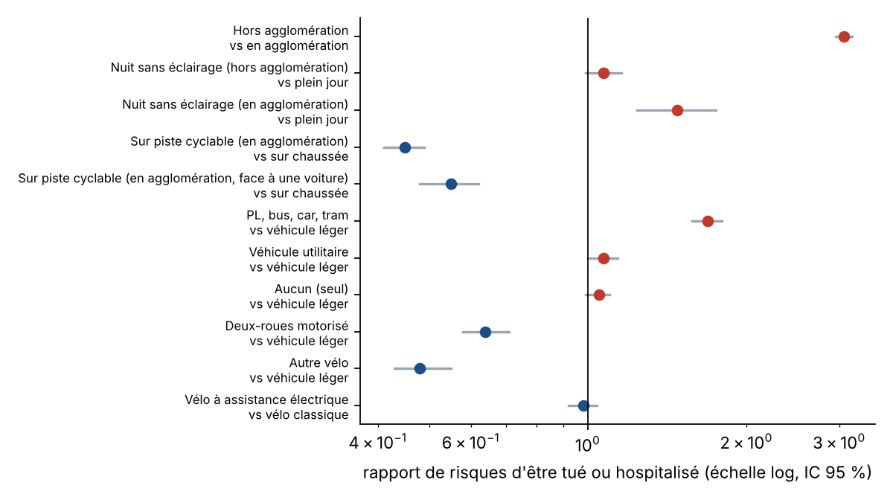

# Accidents de vélo en France, 2020-2024

Quels accidents de vélo sont les plus graves, où et quand ont-ils lieu ? Ce dépôt traite les données publiques des accidents corporels de la route (BAAC) pour les cyclistes, en trois étapes :
1. un dictionnaire des données ;
2. le croisement des données dans l'espace, le temps et par thème, avec des hypothèses testées ;
3. un tableau de bord en ligne.

**Tableau de bord** : https://mouhammadyadex34.github.io/velo-securite/
**Dictionnaire des données** : [`docs/dictionnaire_donnees.md`](docs/dictionnaire_donnees.md)



## Résultats

**Le corpus.** De 2020 à 2024, 27 885 accidents corporels ont impliqué un vélo ou un vélo à assistance électrique (VAE). On y compte :
- 29 446 cyclistes victimes ;
- 8 080 gravement atteints, c'est-à-dire tués dans les 30 jours ou hospitalisés plus de 24 h ;
- dont 1 155 tués.

La part des cyclistes victimes qui roulaient en VAE passe de 6,2 % en 2020 à 13,6 % en 2024.

La mesure utilisée est la part de cyclistes gravement atteints dans chaque groupe. Deux groupes sont comparés par un rapport de risques (RR), avec son intervalle de confiance à 95 %.

| Hypothèse | Groupe comparé | Part de victimes graves | RR [IC 95 %] |
|---|---|---|---|
| H1 Localisation | Hors agglomération vs en agglomération | 62,0 % vs 20,2 % | **3,06** [2,96 ; 3,17] |
| H2 Éclairage | Nuit sans éclairage vs plein jour, en agglomération | 31,0 % vs 21,0 % | **1,48** [1,24 ; 1,75] |
| H2 Éclairage | Nuit sans éclairage vs plein jour, hors agglomération | 66,5 % vs 61,9 % | 1,07 [0,99 ; 1,16], non significatif |
| H3 Piste cyclable | Sur piste vs sur chaussée, en agglomération | 10,1 % vs 22,5 % | **0,45** [0,41 ; 0,49] |
| H3 Piste cyclable | Même comparaison, face à une voiture seulement | 12,6 % vs 23,0 % | **0,55** [0,48 ; 0,62] |
| H4 Antagoniste | Poids lourd, bus, car, tram vs voiture | 47,2 % vs 28,0 % | **1,69** [1,58 ; 1,80] |
| H4 Antagoniste | Autre vélo vs voiture | 13,6 % vs 28,0 % | **0,48** [0,43 ; 0,55] |
| H5 VAE | VAE vs vélo classique | 26,9 % vs 27,5 % | 0,98 [0,92 ; 1,04], non significatif |

Ce qu'on peut retenir :
- **Hors agglomération, un accident de vélo est trois fois plus souvent grave.** C'est l'écart le plus fort, cohérent avec des vitesses plus élevées.
- **En ville, la nuit sans éclairage public augmente la part d'accidents graves de près de moitié.** Hors agglomération, le risque est déjà si élevé que l'éclairage ne change plus rien de mesurable.
- **Sur une piste cyclable, un accident est environ deux fois moins souvent grave que sur la chaussée.** Les pistes comptent davantage d'accidents entre vélos, mais l'effet reste net face à une voiture seulement (RR 0,55).
- **Face à un poids lourd ou un bus, près d'un cycliste sur deux est gravement atteint.**
- **Le VAE n'est pas associé à des accidents plus graves**, alors que sa part progresse.

**Selon la taille de la commune** (`figures/04_taille_commune.png`) :
- dans les villes de plus de 100 000 habitants, on compte 22,5 cyclistes victimes par an pour 100 000 habitants, mais seulement 9 % de cas graves ;
- dans les communes de moins de 2 000 habitants, on en compte 4,6 pour 100 000, mais deux sur trois sont graves ;
- le nombre de cas graves par habitant reste du même ordre partout, de 1,7 à 3,1 pour 100 000.

**Dans le sud-ouest**, la carte détaille les 675 cyclistes victimes des Pyrénées-Atlantiques et des Landes (182 gravement atteints, 28 tués). Les communes les plus touchées sont Pau (184), Anglet (57), Bayonne (51) et Biarritz (42).

## Méthode

**Données.** Les données viennent des bases BAAC 2020-2024 (ONISR, [data.gouv.fr](https://www.data.gouv.fr/fr/datasets/bases-de-donnees-annuelles-des-accidents-corporels-de-la-circulation-routiere-annees-de-2005-a-2024/), Licence Ouverte), restreintes aux accidents dont au moins un véhicule est une bicyclette (`catv = 1`) ou un VAE (`catv = 80`). Les populations communales viennent de geo.api.gouv.fr. Le format de la BAAC a changé en 2019, d'où le départ en 2020, dans un format stable.

**Qui est « cycliste ».** Ce sont les conducteurs et passagers d'un vélo. Dans la BAAC, un piéton renversé est rattaché au véhicule qui l'a heurté : 1 679 piétons heurtés par un vélo ont donc été exclus.

**Contrôles de qualité** (`data/processed/qualite.json`, repris dans le dictionnaire) :
- depuis 2023, la table `lieux` contient une ligne par voie d'un carrefour, avec plusieurs lignes pour environ 2 500 accidents par an. Un accident est compté « sur piste » si l'une de ses lignes l'indique ;
- en 2020, le mois est écrit sans zéro (« 3 »), à partir de 2021 avec (« 03 »), d'où 21 valeurs distinctes pour 12 mois ;
- 958 accidents ont lieu outre-mer : ils sont gardés dans les statistiques mais pas sur la carte métropolitaine ;
- 57 codes commune n'existent plus, à cause des fusions de communes ;
- 11 cyclistes ont une gravité non renseignée et sont exclus.

**Tests statistiques.** Rapport des proportions de victimes graves, intervalle de confiance par la méthode du logarithme, test du khi-deux. Les hypothèses et leurs groupes de référence ont été écrits avant de lancer les calculs. La seule exception est H3 bis, ajoutée ensuite pour vérifier une explication alternative de H3.

**Antagoniste.** C'est le véhicule le plus lourd impliqué avec le cycliste, dans cet ordre : poids lourd, bus, car ou tram, puis véhicule utilitaire, véhicule léger, deux-roues motorisé, engin de déplacement personnel. À défaut, c'est un autre vélo ; sinon, le cycliste est seul.

## Limites

- **Sous-déclaration.** La BAAC ne recense que les accidents connus des forces de l'ordre. Les chutes seules et les blessures légères y manquent souvent, davantage hors des grandes villes. Cela gonfle mécaniquement la part de cas graves dans les petites communes et hors agglomération.
- **Pas d'exposition.** Aucune donnée ne dit combien de kilomètres sont parcourus à vélo, ni où. Un taux pour 100 000 habitants n'est pas un risque par trajet, et la hausse du VAE peut refléter sa diffusion plutôt qu'un danger.
- **Associations, pas causes.** Les comparaisons ne tiennent compte que d'une variable à la fois, sauf la stratification par agglomération. Une piste cyclable peut aussi se trouver dans des rues plus lentes : la vitesse maximale médiane y est de 30 km/h, contre 50 km/h sur la chaussée.
- **Casque.** Il n'est pas analysé : le premier équipement noté est « non déterminable » pour 40 % des cyclistes.

## Reproduire

```bash
python -m venv .venv && source .venv/bin/activate
pip install -r requirements.txt
make tout      # nettoyage, analyses, dictionnaire, données du tableau de bord
make tests     # 8 contrôles automatiques
make voir      # tableau de bord sur http://localhost:8000
make donnees   # facultatif : retélécharger la BAAC depuis data.gouv.fr
```

| Fichier | Rôle |
|---|---|
| `src/codes.py` | Nomenclature BAAC : description et libellé de chaque code |
| `src/telecharger.py` | Téléchargement et filtrage vélo des fichiers officiels |
| `src/prepare.py` | Nettoyage, contrôles de qualité, tables `accidents` et `cyclistes` |
| `src/analyse.py` | Hypothèses, rapports de risques, figures |
| `src/dictionnaire.py` | Génération du dictionnaire des données |
| `src/tableau_de_bord.py` | Données agrégées du tableau de bord |
| `dashboard/` | Tableau de bord statique (Leaflet), publié par GitHub Pages |

À chaque envoi sur GitHub, l'intégration continue relance toute la chaîne et les tests, puis republie le tableau de bord.

## Licence

Code sous licence MIT. Données : Licence Ouverte (Etalab), ONISR et geo.api.gouv.fr.
